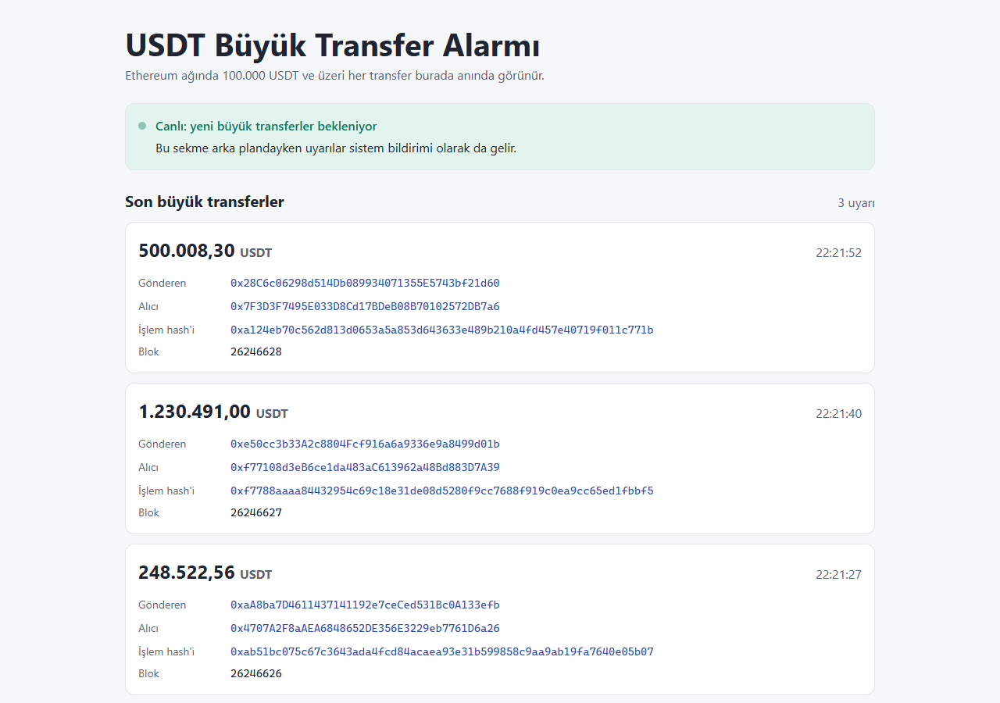
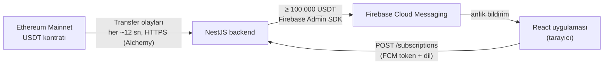
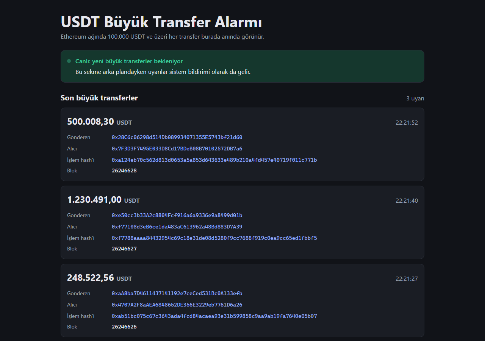
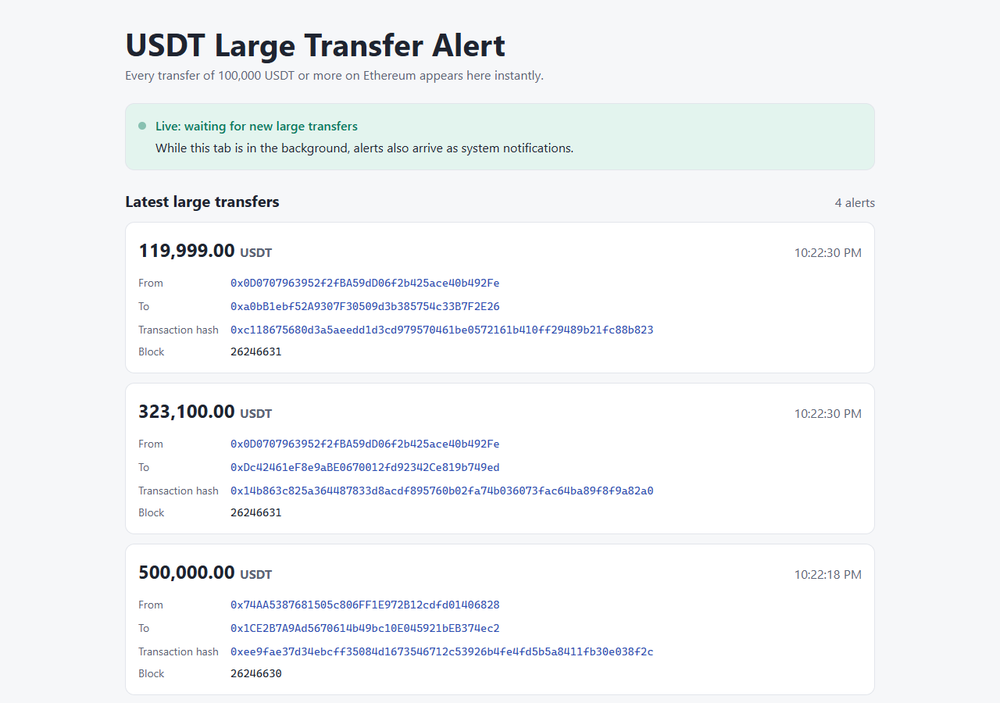
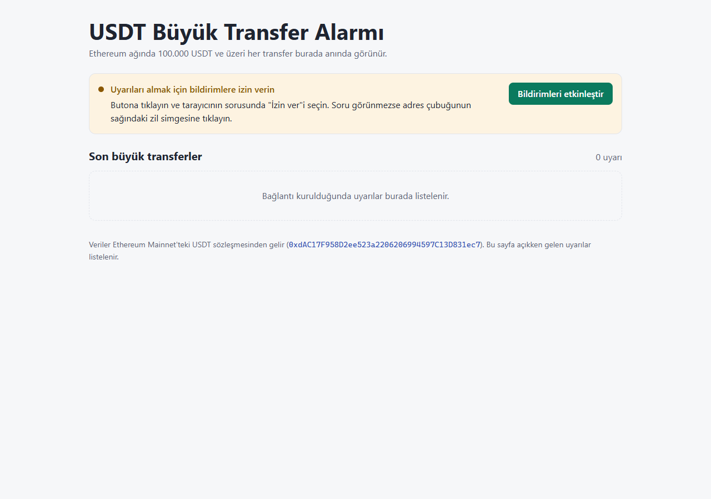
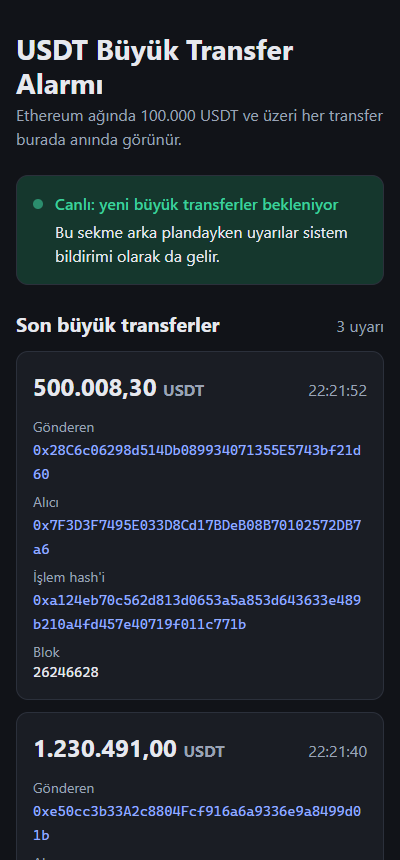

# 🔔 USDT Büyük Transfer Alarmı

Ethereum Mainnet üzerindeki **USDT (Tether)** kontratını izleyen, **100.000 USDT ve üzeri** her transferi tespit eden ve bunu **Firebase Cloud Messaging (FCM)** ile tarayıcıya **anlık bildirim** olarak gönderen bir uygulama.

- **Backend (NestJS):** USDT kontratının `Transfer` olaylarını dinler, büyük transferleri seçer ve Firebase Admin SDK ile gönderir.
- **Frontend (React + Vite):** Bildirimleri alır ve anında kart olarak gösterir. Sekme arka plandayken sistem bildirimi çıkar.



## Hızlı başlangıç

Ayrıntılı açıklamalar aşağıdaki [Kurulum](#kurulum) bölümündedir.

1. Projeyi indirin: `git clone https://github.com/attallay/usdt-large-transfer-alert.git`
2. `backend` ve `frontend` klasörlerinin her birinde `npm install` çalıştırın.
3. `backend/.env.example` dosyasını `backend/.env`, `frontend/.env.example` dosyasını `frontend/.env` olarak kopyalayın ve Alchemy adresini ve Firebase ayarlarını girin.
4. Firebase hizmet hesabı dosyasını `backend/secrets/firebase-service-account.json` olarak kaydedin.
5. Bir terminalde `backend` içinde `npm run start:dev`, diğerinde `frontend` içinde `npm run dev` çalıştırın.
6. **http://localhost:5173** adresini açın, **Bildirimleri etkinleştir**'e tıklayın ve izin verin.

## Nasıl çalışır?



1. **Dinleme:** Backend, [viem](https://viem.sh) ile Alchemy üzerinden Ethereum Mainnet'e bağlanır ve USDT kontratının (`0xdAC17F958D2ee523a2206206994597C13D831ec7`) `Transfer` olaylarını `watchContractEvent` ile izler. Yeni olaylar her ~12 saniyede, yani yaklaşık her blokta alınır.
2. **Eşik ve ondalıklar:** USDT'nin `decimals` değeri **6**'dır; kontrat 1 USDT'yi `1.000.000` olarak saklar. Bu yüzden eşik, ham değer olarak `100.000 × 10⁶ = 100.000.000.000`'dür. Karşılaştırma `bigint` ile yapılır ve miktar `formatUnits(value, 6)` ile kesin ondalık metne çevrilir; kayan nokta yuvarlaması olmaz.
3. **Gönderim:** Eşiği geçen her transfer, Firebase Admin SDK ile abone olan tarayıcıların **cihaz token'larına** (device token) gönderilir. Mesaj; gönderen, alıcı, miktar, işlem hash'i ve blok numarasını veri olarak, ayrıca tarayıcının dilinde hazır bir bildirimi içerir.
4. **Gösterim:** Frontend açıldığında bildirim izni ister, FCM token'ını alır ve `POST /subscriptions` ile backend'e kaydeder. Sekme görünürken her uyarı anında listeye eklenir; sekme arka plandayken *service worker* sistem bildirimi gösterir. Bildirime tıklanınca işlem Etherscan'da açılır.

> Tek bir işlem birden fazla USDT transferi içerebilir (örneğin bir borsa kontratına giriş ve çıkış). Her `Transfer` olayı ayrı bir uyarıdır; bu yüzden aynı işlem hash'ine sahip birden çok kart görülebilir.

## Özellikler

- ⚡ Transferden yaklaşık 12 saniye içinde uyarı (her blok kontrol edilir)
- 🔢 6 ondalığın doğru işlenmesi (`bigint`, hassasiyet kaybı yok)
- 🧾 Her uyarıda gönderen ve alıcı adresi, miktar, işlem hash'i, blok ve saat; hepsi Etherscan bağlantılı
- 🔔 Sekme açıkken listede; arka plandayken miktarı, gönderen → alıcı adreslerini ve işlem hash'ini gösteren bir sistem bildirimi olarak
- 🌐 Tarayıcının diline göre Türkçe veya İngilizce arayüz ve bildirim metni
- 🌓 Sistemin açık/koyu mod ayarına göre otomatik görünüm ve telefon genişliğine uyumlu düzen
- 🩺 Başlangıç kontrolleri: Ethereum bağlantısı (gerçekten Mainnet mi?) ve Firebase kimlik bilgileri
- 🔒 Gizli anahtarlar hiçbir log veya hata mesajına yazılmaz
- ✅ 66 otomatik test

## Kullanılan teknolojiler

| Alan | Teknoloji |
|---|---|
| Backend | [NestJS](https://nestjs.com) 12, TypeScript 6, Node.js 24 LTS |
| Ethereum bağlantısı | [viem](https://viem.sh) 2.57, [Alchemy](https://www.alchemy.com) (JSON-RPC, HTTPS) |
| Bildirimler | Firebase Admin SDK 14 (backend), Firebase JS SDK 12 (frontend), Firebase Cloud Messaging |
| Frontend | [React](https://react.dev) 19, [Vite](https://vite.dev) 8 |
| Test ve kod kalitesi | Vitest 4, Supertest, Oxlint, Prettier |

## Kurulum

### Gereksinimler

- [Node.js](https://nodejs.org) 22 veya üzeri (geliştirmede 24 LTS kullanıldı) ve npm
- [Git](https://git-scm.com)
- Ücretsiz bir [Alchemy](https://dashboard.alchemy.com) hesabı
- Ücretsiz bir [Firebase](https://console.firebase.google.com) projesi (Spark planı yeterlidir)
- Chrome, Edge veya Firefox

### 1. Projeyi indirin ve paketleri yükleyin

```bash
git clone https://github.com/attallay/usdt-large-transfer-alert.git
cd usdt-large-transfer-alert/backend
npm install
cd ../frontend
npm install
```

### 2. Alchemy: Ethereum bağlantı adresi

1. Alchemy panelinde yeni bir uygulama oluşturun: **Ethereum → Mainnet**.
2. Uygulamanın **HTTPS** adresini kopyalayın: `https://eth-mainnet.g.alchemy.com/v2/...`

### 3. Firebase

1. Yeni bir Firebase projesi oluşturun (Google Analytics gerekmez).
2. **Web uygulaması ekleyin** (`</>` simgesi) ve gösterilen `apiKey`, `projectId`, `messagingSenderId`, `appId` değerlerini not edin.
3. **Proje ayarları → Cloud Messaging → Web Push certificates → Generate key pair:** oluşan anahtar, VAPID anahtarıdır.
4. **Proje ayarları → Service accounts → Generate new private key:** inen JSON dosyasını `backend/secrets/firebase-service-account.json` olarak kaydedin.

> ⚠️ Hizmet hesabı dosyası, Firebase projenizin yönetici anahtarıdır. Kimseyle paylaşmayın. `.gitignore`, bu dosyanın ve `.env` dosyalarının Git'e eklenmesini engeller.

### 4. Ortam değişkenleri

Örnek dosyaları kopyalayın ve gerçek değerleri girin:

```powershell
# Windows (PowerShell)
Copy-Item backend\.env.example backend\.env
Copy-Item frontend\.env.example frontend\.env
```

```bash
# macOS / Linux
cp backend/.env.example backend/.env
cp frontend/.env.example frontend/.env
```

**`backend/.env`**

| Değişken | Zorunlu | Açıklama |
|---|---|---|
| `ETH_RPC_URL` | ✔ | Alchemy'nin Ethereum **Mainnet** HTTPS adresi |
| `FIREBASE_SERVICE_ACCOUNT_PATH` | ✔ | Hizmet hesabı dosyasının yolu (örnekteki değer: `./secrets/firebase-service-account.json`) |
| `PORT` | – | Backend portu (varsayılan `3000`) |
| `FRONTEND_ORIGIN` | – | Tarayıcıdan istek göndermesine izin verilen frontend adresi, CORS için (varsayılan `http://localhost:5173`) |

**`frontend/.env`**

| Değişken | Zorunlu | Açıklama |
|---|---|---|
| `VITE_FIREBASE_API_KEY` | ✔ | Firebase web uygulaması ayarı: `apiKey` |
| `VITE_FIREBASE_PROJECT_ID` | ✔ | `projectId` |
| `VITE_FIREBASE_MESSAGING_SENDER_ID` | ✔ | `messagingSenderId` |
| `VITE_FIREBASE_APP_ID` | ✔ | `appId` |
| `VITE_FIREBASE_VAPID_KEY` | ✔ | Web Push sertifikasının açık anahtarı (VAPID) |
| `VITE_BACKEND_URL` | – | Backend adresi (varsayılan `http://localhost:3000`) |

Bir ayar eksik veya hatalıysa uygulama hangisi olduğunu açıkça söyler: backend başlarken, frontend ise sayfada.

## Çalıştırma

İki ayrı terminal açın.

**Backend:**

```bash
cd backend
npm run start:dev
```

Beklenen çıktı:

```
LOG [NotificationsService] Firebase Cloud Messaging is ready
LOG [Bootstrap] Backend listening on http://localhost:3000
LOG [UsdtTransferWatcherService] Connected to Ethereum Mainnet (latest block …)
DEBUG [UsdtTransferWatcherService] Received 78 USDT transfers, 3 of them >= 100,000 USDT
LOG [UsdtTransferWatcherService] 4000000 USDT  0x7F0F… -> 0xfB19…  tx 0xdf8a…
```

**Frontend:**

```bash
cd frontend
npm run dev
```

Tarayıcıda **http://localhost:5173** adresini açın, **Bildirimleri etkinleştir** düğmesine tıklayın ve tarayıcı sorduğunda **İzin ver**'i seçin. Durum "Canlı" olur; büyük transferler genellikle bir dakika içinde görünmeye başlar.

## Testler

| Komut | Klasör | Kapsam |
|---|---|---|
| `npm test` | `backend` | 40 birim testi: eşik ve 6 ondalık, ayar doğrulama, bildirim içeriği ve dili, geçersiz token temizliği, gizli anahtarın hata mesajlarına sızmaması |
| `npm run test:e2e` | `backend` | 5 HTTP testi (`GET /`, `POST /subscriptions`). Gizli anahtar veya internet gerektirmez |
| `npm test` | `frontend` | 21 birim testi: dil seçimi, Türkçe/İngilizce sayı ve saat biçimleri, gelen verinin doğrulanması, ayar kontrolü |

Otomatik testlere ek olarak şu doğrulamalar gerçek Mainnet üzerinde yapıldı:

- **Uçtan uca akış:** transfer → backend → FCM → tarayıcı listesi, gönderimden yaklaşık 1 saniye sonra (headless Edge ile otomatik ve elle).
- **Doğruluk:** uyarılardaki miktar, gönderen ve alıcı Etherscan ile karşılaştırıldı; 4.000.000 USDT'lik bir işlem ham blokzincir verisinden ayrıca çözülerek doğrulandı.
- **Hata senaryoları:** yanlış Alchemy anahtarı, test ağı (Sepolia) adresi, backend kapalıyken açılan sayfa ("Tekrar dene" ile bağlanma), engellenmiş bildirim izni, eksik frontend ayarı.

## API

| Metot | Yol | Açıklama |
|---|---|---|
| `GET` | `/` | Sağlık kontrolü: `{"status":"ok"}` |
| `POST` | `/subscriptions` | Gövde: `{"token": "<FCM token>", "language": "tr"}` (`language` isteğe bağlıdır: `tr` veya `en`, varsayılan `en`). Başarılıysa `201` ve `{"subscribed": true}`; geçersiz istekte veya Firebase'in reddettiği token'da `400` ve açıklama. |

## Ekran görüntüleri

| Türkçe, açık tema | Türkçe, koyu tema |
|---|---|
|  |  |
| **İngilizce tarayıcıda** | **Bildirim izni beklenirken** |
|  |  |

<p align="center"></p>

## Tasarım kararları

1. **WebSocket aboneliği yerine HTTPS ile yoklama (polling).** USDT'de blok başına yaklaşık 100 transfer gerçekleşiyor ve `value` alanı indekslenmediği için tutara göre filtreleme sağlayıcı tarafında yapılamıyor: tüm transferler alınıp backend'de süzülmeli. Alchemy, WebSocket aboneliklerini iletilen veri miktarına göre ücretlendirdiği için ücretsiz aylık kota yaklaşık bir günde biterdi. viem'in `watchContractEvent` fonksiyonu HTTPS üzerinde bir Alchemy filtresi kullanır ve her ~12 saniyede sabit maliyetli tek bir istek yapar (ayda yaklaşık 4,3 milyon CU; ücretsiz kota 30 milyon CU).
2. **Topic yerine cihaz token'ları.** Firebase'in varsayılan hizmet hesabının topic aboneliklerini yönetme izni (`cloudmessaging.topicSubscriptions.create`) yok. Görev "topic veya deviceToken" seçeneği sunduğu için bildirimler doğrudan token'lara gönderilir (`sendEachForMulticast`); ek bir Google Cloud izni gerekmez. Firebase'in geçersiz saydığı token'lar listeden otomatik olarak silinir.
3. **Abone listesi bellekte.** Veritabanı gerekmesin diye token'lar bellekte tutulur. Açık tarayıcılar dakikada bir yeniden kaydolur; böylece backend yeniden başladığında liste en fazla 60 saniyede kendiliğinden dolar.
4. **Dil.** Arayüz, tarayıcının dil tercihine göre Türkçe veya İngilizce açılır. Tarayıcı aboneliğe dilini de ekler ve backend her dil için ayrı bir bildirim metni gönderir.

## Tarayıcı desteği

| Tarayıcı | Durum |
|---|---|
| Chrome, Edge | ✅ |
| Firefox ve LibreWolf | ✅ (LibreWolf, gizlilik için dilinizi İngilizce bildirdiğinden arayüz İngilizce açılabilir) |
| Brave | ⚠️ `brave://settings/privacy` → **"Use Google services for push messaging"** açılmalı, ardından tarayıcı yeniden başlatılmalı |
| DuckDuckGo | ❌ Anlık bildirimleri desteklemiyor |
| Gizli (incognito) pencereler | ❌ |
| Telefon | ⚠️ HTTPS ile yayınlanmış bir adres gerekir: tarayıcılar *service worker* ve anlık bildirimi yalnızca `https://` veya `localhost` adreslerinde çalıştırır |

## Bilinen sınırlamalar

- Uyarılar yalnızca sayfa açıkken listelenir; geçmiş tutulmaz (bunun için bir veritabanı gerekir).
- Olaylar Alchemy'de tutulan bir filtre üzerinden alınır. Kısa bağlantı kopmalarında olay kaybı olmaz; ancak backend birkaç dakikadan uzun süre çevrimdışı kalırsa ya da Alchemy filtreyi kendi tarafında düşürürse (logda `Missing or invalid parameters` uyarısı), viem filtreyi otomatik olarak yeniden oluşturur ve arada geçen kısa sürede (genellikle bir kontrol aralığı) gerçekleşen transferler kaçırılabilir.
- Backend yeniden başladığında abone listesi boşalır; açık tarayıcılar en geç 60 saniye içinde yeniden kaydolur.
- Nadiren bir blok başka bir blokla değiştirilirse (reorg), bir uyarı sonradan farklı bir bloğa giren bir işlemi gösterebilir. Zincirden kaldırılan olaylar (`removed`) zaten yok sayılır.
- Uygulama yerel geliştirme ortamı için hazırlanmıştır. İnternete açılacaksa HTTPS ve `POST /subscriptions` için hız sınırlama eklenmelidir.

## Sorun giderme

| Belirti | Çözüm |
|---|---|
| Backend: `Invalid backend configuration` | `backend/.env` eksik veya hatalı; mesaj hangi değişken olduğunu söyler. |
| Backend: `Could not reach Ethereum through ETH_RPC_URL` | Alchemy adresini ve internet bağlantınızı kontrol edin. |
| Backend: `ETH_RPC_URL points to chain …` | Adres Mainnet'e ait değil (ör. Sepolia); Mainnet adresini kullanın. |
| Backend: arada bir `WARN … Missing or invalid parameters.` | Alchemy olay filtresini düşürmüştür; viem onu otomatik olarak yeniden oluşturur, bir şey yapmanız gerekmez. Her 12 saniyede tekrarlanıyorsa `ETH_RPC_URL` adresini kontrol edin. |
| Backend: `Firebase credentials check failed` | Hizmet hesabı dosyası hatalı veya iptal edilmiş; yenisini indirin. Firebase konsolunda **Proje ayarları → Cloud Messaging** altında "Firebase Cloud Messaging API (V1)" etkin olmalıdır. |
| Sayfa: "Sunucuya ulaşılamadı" | Backend çalışmıyor; başlatıp **Tekrar dene**'ye tıklayın. |
| Sayfa: "Bildirimler bu site için engellenmiş" | Adres çubuğunun solundaki simge → Bildirimler: **İzin ver** → sayfayı yenileyin. |
| Sayfa: "anlık bildirim servisine kaydolamadı" | Tarayıcı push servisini engelliyor (ör. Brave); yukarıdaki tarayıcı tablosuna bakın. |
| Vite: `Port 5173 is already in use` | Başka bir frontend sunucusu açık; onu kapatın. Backend yalnızca `FRONTEND_ORIGIN` adresinden gelen isteklere izin verir. |
| Windows bildirimi görünmüyor | **Ayarlar → Sistem → Bildirimler:** bildirimler açık, tarayıcıya izin verilmiş ve "Rahatsız etmeyin" kapalı olmalı. |

## Proje yapısı

```
usdt-large-transfer-alert/
├── backend/                          NestJS uygulaması
│   ├── src/
│   │   ├── main.ts                   Başlatma ve CORS
│   │   ├── app.module.ts             Modüllerin birleştirilmesi
│   │   ├── app.controller.ts         GET / sağlık kontrolü
│   │   ├── config/                   Ortam değişkenlerinin okunması ve doğrulanması
│   │   ├── blockchain/               USDT Transfer olaylarının izlenmesi; eşik ve ondalık kuralları
│   │   └── notifications/            Firebase gönderimi, POST /subscriptions, bildirim metinleri
│   ├── test/                         HTTP uçtan uca testleri
│   └── .env.example
├── frontend/                         React + Vite uygulaması
│   ├── public/
│   │   └── firebase-messaging-sw.js  Arka plan bildirimleri (service worker)
│   ├── src/
│   │   ├── main.tsx, App.tsx         Başlangıç noktası ve sayfa düzeni
│   │   ├── components/               Arayüz parçaları: durum paneli, uyarı listesi, uyarı kartı
│   │   ├── alerts/                   Bağlantı durumu, FCM token'ı, backend kaydı, gelen uyarıların doğrulanması
│   │   ├── config/                   .env ayarlarının okunması ve hata türleri
│   │   ├── i18n/                     Türkçe/İngilizce metinler ve dil seçimi
│   │   └── utils/                    Sayı ve saat biçimleri, Etherscan bağlantıları
│   └── .env.example
└── docs/screenshots/                 README ekran görüntüleri
```

## Güvenlik

- `.env` dosyaları ve `backend/secrets/` klasörü Git'e eklenmez (`.gitignore`); depoda yalnızca `.env.example` şablonları bulunur. Tüm Git geçmişi, yayınlanmadan önce gizli değerlere karşı tarandı.
- Alchemy adresi API anahtarını içerdiği için hiçbir log veya hata mesajına yazılmaz; bunu bir test doğrular.
- Firebase web ayarları ve VAPID açık anahtarı tasarım gereği gizli değildir; zaten tarayıcıya gönderilirler.
- `@firebase/util` ve `protobufjs` paketlerinin npm kurulum betikleri incelendi; gerekli olmadıkları için `package.json` içindeki `allowScripts` ile engellendi.
- `npm audit` her iki klasörde de bulgu göstermez. Bunun için kullanılmayan `@nestjs/mau` geliştirme aracı kaldırıldı ve frontend'de kullanılmayan Firestore bileşeninin bağımlılığı `@grpc/grpc-js`, `overrides` ile güvenlik düzeltmesi içeren sürüme (1.13.6) sabitlendi. Firestore kodu derlenmiş uygulamada yer almaz.
